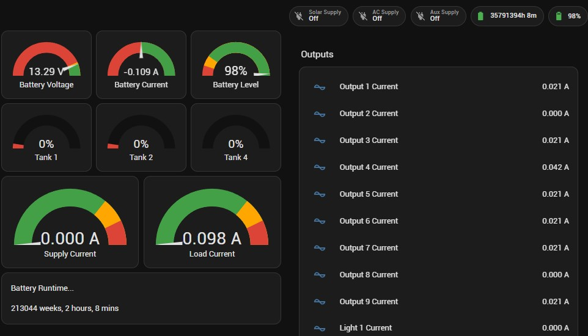

# ESPHome BMPro OdysseyLink ODL104

ESPHome configuration used to connect a BMPro OdysseyLink RV Battery Management system to Home Assistant in order to mointor a number of sensors including

- Battery Voltage
- Battery charge / discharge Currrent
- Battery Level %
- Output states and their current draw
- Supply sources (AC, Solar, Aux)
- Tank Levels

It uses bluetooth to connect to a BMPro OdysseyLink ODL104 (and possibly a ODL105) CAN-Bus to BLE gateway and bring the Battery Management Systems data into Home Assistant.

Only the OdysseyLinks bluetooth MAC address is required. The ESP32 does not need to pair with the OdysseyLink.

The OdysseyLink ODL104 uses a single BLE Characteristic Notification to notify all of its data values, with the data containing the packet Type, Data Source, Register ID and payload value as a byte array.

This [bmpro-odl104.yaml](bmpro-odl104.yaml) file receives these notifications, decodes the packet then updates various HA sensors accoridngly

Let me know if you discover any other register values that could be added to the list!

You can view the Protocol format [HERE](protocol.md)

